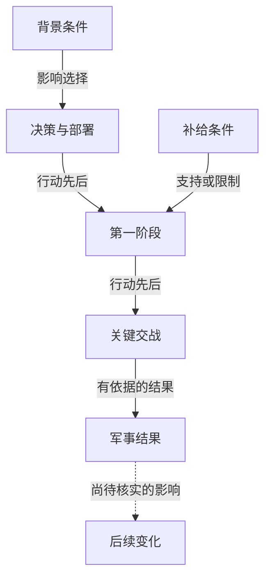

# Mermaid 历史图解

## 选择图形

| 问题 | 推荐表达 |
|---|---|
| 人物、势力、亲属、指挥关系 | `flowchart LR` 或 `TB`，边标关系与时期 |
| 历史时间线、制度沿革 | `timeline`，按已知精度标日期；需分支并行时用 `flowchart` |
| 事件本末、战争阶段 | `flowchart TB`，先后与因果标清楚 |
| 机构、职官、仪式、选任程序 | 层级或流程 `flowchart` |
| 学术论证 | `flowchart`，节点注明论点、证据和作者解释 |

精确表格仍保留日期、品秩、数据和来源。Gantt 仅在已知起止时间且兼容时使用，不为画条形图编造日期。

## 来源与语义

- 图前说明主题、时间地区、来源范围及其是原书记载、作者解释还是综合整理。图下给关键节点／边的来源表与必要限制。
- 箭头明确标注先后、因果、统属、联盟、对立、实际移动或资料关联。没有证据的因果不用实线伪装；推断可用虚线并标“推断”，争议需文字解释，不能只靠颜色。
- 人物关系随时间变化，按时期、势力、事件分图。不把后来的官职、身份、对立写进早期关系图。
- 同期事件并列，无法确定先后的事件不连顺序箭头。年号换算不确定则保留原纪年。
- 战争行动图只是顺序和连接示意，说明不按地理比例；真实方位、距离与地形须有地图依据。

## 可读性与语法

使用 `mermaid` 围栏、英文稳定节点 ID 和双引号中文标签。标签简短；详细事实和原文锚点放正文，节点中不放 Obsidian 双链。避免把保留字用作 ID，不要求交互 click 链接以免渲染器不支持。

通常每图约 6–12 个主要节点，按语义拆分而非硬凑数。全书图给主要阶段并链接阶段图；章节图只解释本篇，专题图综合相关来源。复杂关系、战争和制度在建档时主动配图，简单内容无需装饰性图表，不强制每篇两张图。

下面是结构示例，不是可复制的历史事实：

有现成渲染环境时检查语法和可读性；无渲染环境时检查围栏、节点、边和来源，明确未验证实际渲染。不要把链接检查脚本的成功称为 Mermaid 渲染成功。
